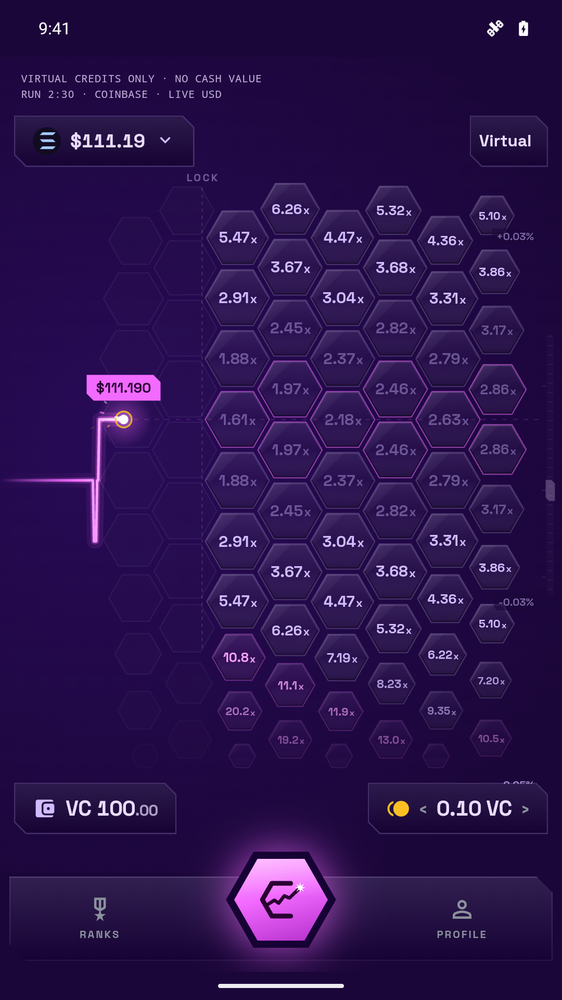
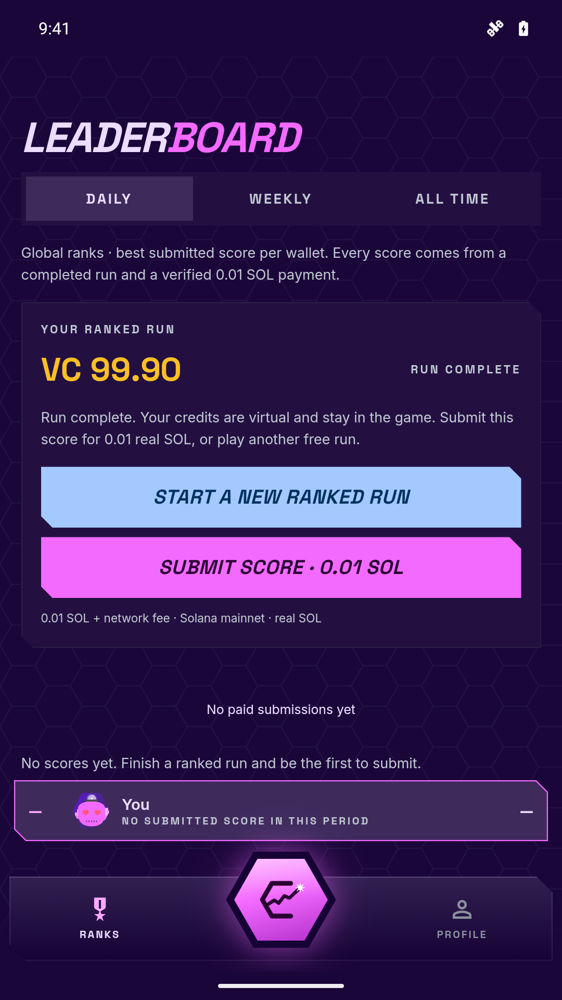
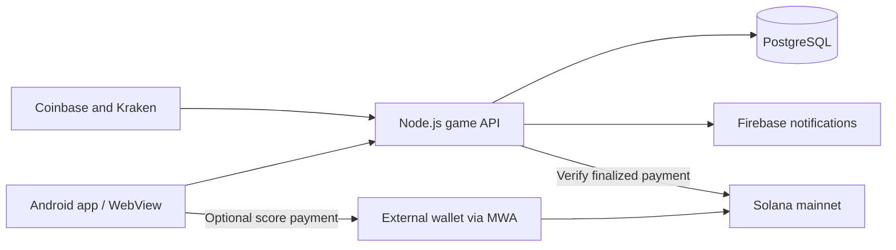

<p align="center"></p>

# Hexit for Solana Seeker

**A honeycomb market game for your phone — with Solana Devnet and MagicBlock services on the roadmap.**

Hexit turns live SOL/USD and BTC/USD price movement into a tap-to-play hexagonal board. Pick a tile, follow the price, and build your score through a three-minute run. Built for Solana Seeker with an Android app, Mobile Wallet Adapter, live exchange feeds, and a persistent leaderboard.

[Website](https://digitalchocolate.co/hexit/) · [Download APK](https://github.com/penguinpecker/hexit-seeker/releases/latest) · [Android source](android/app/src/main) · [Backend source](server)

## Solana Devnet + MagicBlock

The next on-chain version is planned around **Solana Devnet**, **MagicBlock VRF**, and **MagicBlock Ephemeral Rollups**. This repository publishes the current app and the intended integration architecture so development can continue in public.

| Component | Intended role | Status |
| --- | --- | --- |
| Solana Devnet | Deploy and test Hexit game programs, accounts, and settlement with test assets. | Planned for the next on-chain version. |
| MagicBlock VRF | Supply verifiable randomness for future game mechanics that require randomness. The exact mechanic will be defined during implementation. | Planned; no VRF requests or callbacks in v0.3.1. |
| MagicBlock Ephemeral Rollups | Execute frequent game-state updates on delegated accounts and commit results back to Solana. | Planned; no account delegation or rollup execution in v0.3.1. |
| Solana Mobile Wallet Adapter | Connect an external Solana wallet and request approval for optional score-publication payments. | Implemented in the Android app. |

**Current release:** v0.3.1 is a working virtual-credit game backed by a live API. It is **not yet a live Solana Devnet/MagicBlock deployment**. Its optional leaderboard payment uses **Solana mainnet**, costs **0.01 real SOL plus network fees**, and requires explicit wallet approval. Publishing this repository does not change the APK's network or payment behavior.

### Planned MagicBlock flow

1. Deploy a Hexit program and create game/session accounts on Solana Devnet.
2. Delegate the accounts needed for active play to a MagicBlock Ephemeral Rollup.
3. Process game actions against delegated state for responsive play.
4. Request MagicBlock VRF when a future mechanic needs randomness, then consume the verified result in an authenticated callback.
5. Commit game-state updates back to Solana and undelegate when the session ends.

VRF is intended for randomized mechanics; the current SOL/USD and BTC/USD charts use real exchange prices. Program addresses, transaction links, and integration tests will be added when the Devnet implementation is deployed.

Architecture references: [MagicBlock Ephemeral Rollups](https://docs.magicblock.gg/pages/get-started/introduction/ephemeral-rollup), [Solana VRF and its request/callback flow](https://github.com/magicblock-labs/solana-vrf), and [Ephemeral Rollups SDK](https://github.com/magicblock-labs/ephemeral-rollups-sdk).

## Play Hexit

- **Tap the honeycomb:** choose a future price/time tile on the SOL or BTC board.
- **Three-minute runs:** each run starts with 100 free virtual credits (VC).
- **Live markets:** Coinbase and Kraken provide public USD last-trade prices; the backend samples the selected feed every 100 ms.
- **Responsive feedback:** canvas rendering, procedural sound effects, adaptive music, and Android haptics.
- **Persistent rankings:** daily, weekly, and all-time leaderboards with pagination and a player's overall rank.
- **Optional notifications:** Firebase Cloud Messaging can notify players when runs finish or scores are published.

Virtual credits have no cash value and cannot be transferred, withdrawn, or exchanged for SOL. Guest gameplay needs no wallet. Stale feeds pause entries; feed interruptions and source changes refund open virtual-credit entries.

<p align="center">
  
  
</p>

## Android APK

| Detail | Value |
| --- | --- |
| Release | **0.3.1** — version code **4** |
| Package | `com.hexit.seeker` |
| Minimum Android | Android 9 / API 28 |
| Target SDK | API 35 |
| APK | [Hexit-Seeker-0.3.1-signed.apk](deliverables/Hexit-Seeker-0.3.1-signed.apk) |
| Checksum | [SHA256SUMS.txt](deliverables/SHA256SUMS.txt) |

Download the signed APK from [GitHub Releases](https://github.com/penguinpecker/hexit-seeker/releases/latest), transfer it to your Android device, and open it to install. Allow installation from that source if Android asks. This is a direct APK distribution; publication here does not imply a dApp Store listing.

To check the repository copy on macOS:

```sh
cd deliverables
shasum -a 256 -c SHA256SUMS.txt
```

The APK is signed with the existing Hexit release key. Private signing material is excluded from the repository. Testing to date includes Android emulators; physical Seeker hardware has not yet been used for validation.

## How the current app works



The server owns run state, validates entries, computes outcomes, and persists scores. One database advisory-lock leader owns the market feed and settlement loop. The client receives live market and run events over Server-Sent Events.

Publishing a completed score is a separate flow: the API creates a transfer with a run-bound memo, the client validates the full transaction, the external wallet asks for approval, and the server verifies the finalized payment before publishing. Saved receipts and unique run/signature constraints prevent duplicate publication. The current recipient is `6zuPtQg1rygxNgzZmjn13YB3bqMGiMLbPAWbrbvwJykg`.

Live API: [configuration](https://hexit-leaderboard-production.up.railway.app/config) · [health](https://hexit-leaderboard-production.up.railway.app/health) · [markets](https://hexit-leaderboard-production.up.railway.app/markets).

Guest sessions are stored on the device and expire after 90 days unless renewed. Clearing app data loses access to that guest's runs; cross-device guest-account recovery is not implemented.

## Repository layout

| Path | Contents |
| --- | --- |
| [`android/`](android/) | Native Android shell, WebView bridge, Mobile Wallet Adapter, notifications, Gradle wrapper. |
| [`web/`](web/) | Game UI, canvas board, wallet/API client, audio, icons, fonts, and tests. |
| [`server/`](server/) | Game service, live market feeds, PostgreSQL schema, payment verification, leaderboard, and push queue. |
| [`pricing/`](pricing/) | Hexagon pricing, quote generation, integer geometry, and reference-vector tests. |
| [`scripts/`](scripts/) | Asset builds, release tooling, and verification utilities. |
| [`brand/`](brand/) | Hexit logos and brand artwork. |
| [`deliverables/`](deliverables/) | Signed APK and SHA-256 checksum. |

## Build from source

Use **Node.js 22.18 or newer** (the backend container uses Node 24). Android builds also need **JDK 17 or newer**, Android SDK Platform **35**, and Build Tools **36.0.0**. The Gradle wrapper is included.

```sh
git clone https://github.com/penguinpecker/hexit-seeker.git
cd hexit-seeker
npm ci
npm test
npm --prefix pricing test
npm run build
npm run dev
```

Open `http://127.0.0.1:4198` for the browser preview. By default it connects to the live API in `deployment.json`. The Android APK provides the native Mobile Wallet Adapter flow.

After `npm run build`, build a debug APK:

```sh
cd android
./gradlew :app:assembleDebug
```

Set `JAVA_HOME` and `ANDROID_HOME` for your machine, or configure the SDK through Android Studio. The output is `android/app/build/outputs/apk/debug/app-debug.apk`. Debug builds use the separate package `com.hexit.seeker.debug`.

For a signed release, run `python3 scripts/release.py` from the repository root after configuring those environment variables. It creates a local signing key if none exists, builds the checked-in UI, runs Android release lint, verifies the signature and ZIP alignment, and writes the APK/checksum. An independently signed build cannot update an installation signed with the original publisher key. Preserve your own `keys/` directory privately.

The older UI-adaptation helpers are optional maintainer tools. `--regenerate-ui` requires `HEXIT_ORIGINAL_APP` pointing to the original Hexit `app/` directory; ordinary builds need only this repository. `HEXIT_ORIGINAL_APP` also enables optional source-asset parity checks during `npm run build`.

## Backend development

The backend uses Node.js, PostgreSQL, public exchange WebSockets, and optional Firebase Cloud Messaging. Start a local PostgreSQL database, then:

```sh
cp .env.example .env
# Configure DATABASE_URL in .env for your local database.
node --env-file=.env server/main.ts
```

The service applies `server/schema.sql` on startup and listens on port `8789` by default. Leaving `FEE_TREASURY` empty disables score payments on that server; leaving `FCM_SERVICE_ACCOUNT_JSON` empty disables push delivery. The current payment code accepts only `mainnet-beta`; changing an environment variable does not implement the planned Devnet game.

To point a custom client at another API, set `HEXIT_API` when building and update the web Content Security Policy plus the Android API URL and external-link allowlist to match. Firebase client configuration files contain public app identifiers, as described in the [Firebase API key documentation](https://firebase.google.com/docs/projects/api-keys). Private service-account credentials belong only in server environment variables.

The included Dockerfile and `railway.toml` describe the hosted backend. Keep database URLs, Firebase service-account keys, wallet keys, and release keystores out of Git.

## Checks and roadmap

`npm test` covers virtual-credit accounting, market-feed validation, and payment transaction checks. `npm --prefix pricing test` covers pricing reference values, quote boundaries, and settlement geometry. The signed APK's checksum is included. A real mainnet score-payment broadcast has not been performed by the verification scripts.

- [x] Android app source and signed APK.
- [x] Live SOL/USD and BTC/USD gameplay, server-owned runs, and PostgreSQL rankings.
- [x] Mobile Wallet Adapter payment flow and Firebase notification support.
- [ ] Hexit game program deployed on Solana Devnet.
- [ ] MagicBlock Ephemeral Rollup delegation, execution, and commit lifecycle.
- [ ] MagicBlock VRF requests and authenticated callbacks for defined random mechanics.
- [ ] Published program IDs, Devnet transaction examples, and end-to-end integration tests.
- [ ] Physical Solana Seeker device validation.

## Links and license

Built by **Digital Chocolate**. [Website](https://digitalchocolate.co/hexit/) · [Support](mailto:digitalchocolate@gmail.com) · [Privacy](https://digitalchocolate.co/hexit/legal/privacy.html) · [Terms](https://digitalchocolate.co/hexit/legal/terms.html).

Source is published for reference under the existing [LICENSE](LICENSE), which reserves all rights. Public repository visibility does not grant an open-source license; third-party components retain their own licenses.
